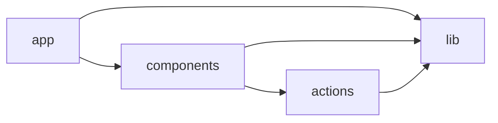

# SnippetBox (Next.js)

A small app for sharing short snippets of text and code that expire on their own, built as a single Next.js application with a **layered, server-first** structure.

Data is stored in an embedded SQLite database through `better-sqlite3`. Pages read the database on the server and every write goes through a Next.js Server Action, so the app has no JSON API.

**Stack:** Next.js 16 (App Router) · React 19 · TypeScript · SQLite (better-sqlite3) · Vitest + Testing Library · Playwright · Docker · GitHub Actions

## Contents

- [Quick start](#quick-start)
- [Features](#features)
- [Configuration](#configuration)
- [Architecture](#architecture)
- [Routes and actions](#routes-and-actions)
- [Persistence](#persistence)
- [Testing](#testing)
- [CI](#ci)
- [Limits](#limits)
- [References](#references)

## Quick start

Requires Node.js 22.

```sh
cd snippetbox
npm ci
npm run dev
```

The app runs at http://localhost:3000.

| Goal                     | Command                                       |
| ------------------------ | --------------------------------------------- |
| Run in development       | `npm run dev`                                 |
| Run the production build | `npm run build && npm start`                  |
| Run the Vitest suites    | `npm test`                                    |
| Run with Docker          | `make docker/up` (from `snippetbox-docker`)   |
| Stop Docker              | `make docker/down` (from `snippetbox-docker`) |

Every setting has a default, so no environment file is needed. Set variables in the shell or in `.env.local` to override them. `PORT` overrides the host port in Docker. The Docker setup keeps the database in the `snippetbox-data` named volume mounted at `/app/data`.

## Features

- **Authentication**: sign up, sign in, sign out, 12-hour sessions stored server-side behind an `HttpOnly` cookie, passwords hashed with PBKDF2-SHA256.
- **Snippets**: create a snippet with a title of up to 100 characters and a body that expires after one day, one week or one year (one year by default).
- **Browsing**: the home page lists the 10 latest active snippets, newest first. Each snippet has a public page addressed by its numeric id.
- **Expiry**: expired snippets are hidden from the list and their page returns `404`.
- **Platform**: flash messages, light and dark theme, `/ping` health check.

Snippet titles and content are rendered as plain text, which keeps rendering safe by default without a Markdown or sanitization dependency.

## Configuration

| Variable        | Default                                 | Purpose                                                      |
| --------------- | --------------------------------------- | ------------------------------------------------------------ |
| `PORT`          | `3000`                                  | HTTP port                                                    |
| `DATABASE_PATH` | `./data/snippetbox.db`                  | SQLite file; parent directories are created on start         |
| `COOKIE_SECURE` | `true` in production, `false` otherwise | Adds the `Secure` attribute to the session and flash cookies |

The Docker image sets `DATABASE_PATH` to `/app/data/snippetbox.db`. The local compose file defaults `COOKIE_SECURE` to `false` so login works over plain HTTP; run `COOKIE_SECURE=true make docker/up` when serving through HTTPS.

## Architecture

SnippetBox is a single Next.js application split into four layers. Pages and components depend downward on server actions and the `lib` layer, and `lib` depends on nothing else in the app.

### Project layout

```
src/
  app/              Next.js routes: pages, layout, not-found, /ping
  components/       forms, navigation, flash, snippet card and table
  actions/          Server Actions: sign up, log in, log out, create snippet
  lib/              auth and sessions, SQLite connection, snippets,
                    flash, form state, expiry options, date format, config
tests/
  unit/             pure logic, config and hashing
  integration/      real SQLite: repositories, auth, actions, pages, /ping
  components/       React components in jsdom
  e2e/              Playwright journeys in Chromium
  helpers/          cookie jar, navigation signals, temporary database, forms
  setup/            Vitest setup for the node and jsdom projects
```

### Layer dependencies

Arrows point from a layer to the layer it depends on. The graph is acyclic.



### Dependency direction

- `lib` never imports `actions`, `components` or `app`.
- `actions` import only from `lib`.
- `components` import from `actions` and `lib`; `app` imports from `components` and `lib`.
- Only `lib/db.ts` talks to `better-sqlite3`. Server-side cookie access lives in `lib/auth.ts` and `lib/flash.ts`, and both take their cookie options from `lib/config.ts`.

### Request flow

- **Reads**: `app/page.tsx` and `app/snippet/view/[id]/page.tsx` are rendered dynamically on every request and query SQLite through `lib/snippets.ts`. An id that is not a number, does not exist or has expired renders `404`.
- **Writes**: each form is a client component that binds a Server Action with `useActionState`. The action validates the input and either returns field errors together with the submitted values, or performs the write, sets a flash message and redirects.
- **Authentication**: `getCurrentUser` reads the session cookie, is cached for the duration of a request and never selects the password hash. `SiteNav`, the create page and `createSnippetAction` all check it, so a signed-out visitor is redirected to `/user/login`.
- **Form state**: the password is never returned to the browser in form state, so a failed submission always shows an empty password field.

### Sessions and flash messages

A session is a random 256-bit token stored in an `HttpOnly`, `SameSite=Lax` cookie that expires after 12 hours. Only the SHA-256 hash of the token is stored in the `sessions` table. Logging in replaces the previous session of that browser and purges expired sessions. Logging in with an unknown email still performs a password verification against a decoy hash, so response time does not reveal which accounts exist.

A flash message travels in a short-lived `snippetbox_flash` cookie that lives for 60 seconds. It is readable by script on purpose: the `ClearFlash` client component expires it once the message has been displayed.

## Routes and actions

### Pages

| Route               | Purpose                                                      |
| ------------------- | ------------------------------------------------------------ |
| `/`                 | Home with the latest snippets                                |
| `/user/signup`      | Create an account                                            |
| `/user/login`       | Sign in                                                      |
| `/snippet/create`   | Create a snippet; redirects to `/user/login` when signed out |
| `/snippet/view/:id` | A single snippet                                             |
| `/ping`             | Health check, returns `OK` as plain text                     |

### Server Actions

| Action                | Result on success                                               |
| --------------------- | --------------------------------------------------------------- |
| `signupAction`        | Creates the user, flashes a message, redirects to `/user/login` |
| `loginAction`         | Starts a session, redirects to `/snippet/create`                |
| `logoutAction`        | Ends the session, flashes a message, redirects to `/`           |
| `createSnippetAction` | Stores the snippet, flashes a message, redirects to its page    |

### Validation

| Field           | Rule                                                                |
| --------------- | ------------------------------------------------------------------- |
| Name            | Required                                                            |
| Email           | Required, valid format, unique ignoring case on sign up             |
| Password        | Required, at least 8 characters on sign up                          |
| Snippet title   | Required, at most 100 characters (counted as characters, not units) |
| Snippet content | Required                                                            |
| Snippet expiry  | Must equal `1`, `7` or `365` days                                   |

Invalid submissions return field messages and keep what the visitor typed, except passwords. A failed login always shows the same message, whether the email is unknown or the password is wrong.

## Persistence

The database runs with WAL journaling, foreign keys on and a 5 second busy timeout. The schema is created on the first connection with `CREATE TABLE IF NOT EXISTS`.

| Table      | Notes                                                                                                            |
| ---------- | ---------------------------------------------------------------------------------------------------------------- |
| `users`    | unique case-insensitive `email`; the password is stored only as a salted PBKDF2 hash                             |
| `sessions` | primary key is the SHA-256 hash of the token, never the token; removed with its user through `ON DELETE CASCADE` |
| `snippets` | indexed by `expires`; ids use `AUTOINCREMENT` and are never reused                                               |

Timestamps are stored as ISO 8601 UTC strings and displayed in UTC. Listings and lookups filter out expired snippets in SQL.

## Testing

| Layer         | Command                    | What it proves                                                                                                         |
| ------------- | -------------------------- | ---------------------------------------------------------------------------------------------------------------------- |
| Unit          | `npm run test:unit`        | Date formatting, expiry options, form state, cookie config, flash cookie and password hashing                          |
| Integration   | `npm run test:integration` | Schema and pragmas, repositories, sessions, every Server Action and page on a real temporary SQLite file               |
| Components    | `npm run test:components`  | Forms, navigation, flash, table and card in jsdom, with Server Actions replaced by stubs                               |
| E2E (browser) | `npm run test:e2e`         | Playwright journeys in Chromium against a production build                                                             |

`npm test` runs the first three layers. `npm run test:coverage` runs them with V8 coverage and writes the report to `coverage/`. `npm run test:all` runs everything, including the browser suite.

`npm run test:e2e` builds the app, starts it on port `3100` (override with `E2E_PORT`) with a throw-away database and `COOKIE_SECURE=false`, then runs the specs. Install Playwright's browser once with `npx playwright install chromium`. To reuse an existing Chromium, set `CHROMIUM_PATH`.

### Conventions

- Every unit and integration test gets a real SQLite file in a fresh temporary directory, so no test depends on another.
- Only `next/headers` and `next/navigation` are replaced in node tests, with an in-memory cookie jar and redirect and not-found signals that tests can assert on.
- Time is controlled with fake timers for `Date` only, which proves expiry at the exact boundary.
- Source, tests and configuration contain no code comments; names carry the intent.

## CI

`.github/workflows/ci.yml` runs these jobs:

1. **Quality**: lint, typecheck, unit, component and integration tests, then the coverage run, which is uploaded as an artifact.
2. **Build**: production build.
3. **E2E**: the Playwright suite in Chromium. It builds and starts the app itself, and uploads the report and traces when it fails.
4. **Docker**: image build plus a smoke test that waits for `/ping`, requests every page and checks that an unknown snippet returns `404`.
5. **Commitlint**: commit message linting on pull requests. Scopes are `snippetbox`, `docker`, `ci` and `deps`.

## Limits

- SQLite is a single-writer embedded database, so this layout suits one application instance with a persistent disk. Running several replicas requires moving `lib/db.ts` and `lib/snippets.ts` to a networked database.
- Expired snippets are hidden but never deleted from the database, and snippets cannot be edited or deleted by their authors.
- Expired sessions are purged when someone logs in, not on a schedule.
- There is no rate limiting on login or sign up, no password reset and no email verification.
- Serving over plain HTTP on a host other than `localhost` requires `COOKIE_SECURE=false`, otherwise the browser drops the cookies and login appears to fail.

## References

- [Next.js documentation](https://nextjs.org/docs) – App Router, Server Actions and route handlers
- [Next.js `output: "standalone"`](https://nextjs.org/docs/app/api-reference/config/next-config-js/output) – minimal production server used in the Docker image
- [React documentation](https://react.dev) – `useActionState` and form actions
- [Vitest](https://vitest.dev) · [Testing Library for React](https://testing-library.com/docs/react-testing-library/intro/) · [Playwright](https://playwright.dev)
- [better-sqlite3](https://github.com/WiseLibs/better-sqlite3) – synchronous SQLite driver
- [SQLite: write-ahead logging](https://www.sqlite.org/wal.html) · [SQLite: foreign keys](https://www.sqlite.org/foreignkeys.html)
- [MDN: HTTP cookies](https://developer.mozilla.org/en-US/docs/Web/HTTP/Cookies)
- [MDN: `SubtleCrypto.deriveBits()`](https://developer.mozilla.org/en-US/docs/Web/API/SubtleCrypto/deriveBits) – PBKDF2 password hashing
- [Docker multi-stage builds](https://docs.docker.com/build/building/multi-stage/)
- [Conventional Commits](https://www.conventionalcommits.org/) – commit message format enforced by commitlint
